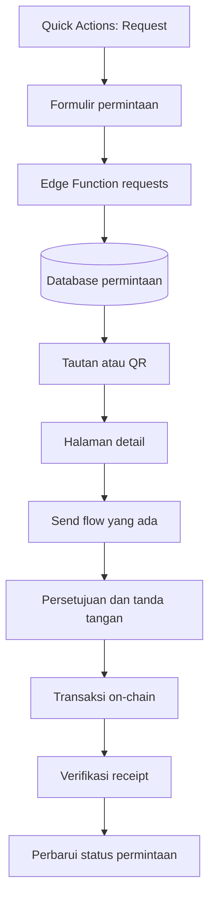

# Arsitektur Pukico

**Status:** Dokumen kerja. Validasi terhadap kode produksi masih diperlukan.

## Tujuan
Menjelaskan batas tanggung jawab komponen dan cara menambahkan Request Money tanpa menggandakan alur transaksi.

## Komponen yang diketahui
- Dashboard: React, TypeScript, Vite.
- Wallet dan autentikasi: Privy.
- Interaksi blockchain: viem.
- Backend dan database: Supabase dan Edge Functions.
- API transaksi frontend: `src/lib/txApi.ts`.
- Konteks transaksi: `src/context/TxContext.tsx`.
- API teman: `src/lib/friendsApi.ts`.
- Konteks teman: `src/context/FriendsContext.tsx`.
- UI Quick Actions: `src/components/views/sheets/QuickActionSheets.tsx`.
- Form Send untuk audit: `src/components/views/sheets/SendSheetContent.tsx`.

Daftar ini berasal dari pemeriksaan awal dan harus dicocokkan dengan repository aktif.

## Batas tanggung jawab

### Frontend
Menampilkan formulir, validasi awal, detail, status, dan tindakan pengguna. Frontend bukan sumber kebenaran status pembayaran.

### API `requests`
Modul frontend untuk mengirim operasi permintaan ke backend. Nama `src/lib/requestsApi.ts` adalah usulan.

### Edge Function `requests`
Menangani pembuatan, pembacaan, pembatalan jika diizinkan, dan validasi perubahan status. Setiap operasi memeriksa identitas dan akses pengguna.

### Database
Menyimpan permintaan dan referensi pembayaran. Nama `payment_requests` adalah usulan; periksa skema sebelum membuat tabel.

### Alur `tx`
Tetap menangani transfer dan verifikasi yang sudah tersedia. Request Money tidak boleh mengirim dana sendiri atau menggandakan logika wallet.

## Alur pembuatan
1. Pengguna terautentikasi mengisi penerima, nominal, dan catatan.
2. Frontend memvalidasi input untuk UX.
3. Backend memvalidasi identitas, penerima, nominal, dan jaringan.
4. Backend menyimpan permintaan dengan ID unik dan status awal `pending`.
5. Frontend menampilkan detail dan tautan/QR.

## Alur pembayaran
1. Penerima membuka detail.
2. Backend memeriksa akses dan status terkini.
3. Frontend mengisi Send dengan data permintaan yang tervalidasi.
4. Pengguna memeriksa tujuan, nominal, jaringan, dan biaya.
5. Pengguna menyetujui dan menandatangani.
6. Mekanisme tepercaya memeriksa receipt, token, jaringan, tujuan, dan nominal.
7. Status diperbarui secara idempotent setelah kecocokan terkonfirmasi.
8. Jika update database gagal, sistem menyinkronkan ulang berdasarkan transaksi terverifikasi.

## Diagram alur

## Prinsip
- Satu sumber kebenaran untuk status transaksi.
- Jangan membuat wallet baru untuk permintaan.
- Jangan menduplikasi verifier tanpa alasan jelas.
- Operasi yang bisa dipanggil ulang harus idempotent.
- Perubahan database harus melalui migrasi yang bisa ditinjau.
- Pertahankan API yang ada jika tidak ada alasan kuat untuk mengubahnya.
- Periksa build dan tes setelah perubahan.

## Belum dipastikan
Dokumen ini belum mengklaim topologi deployment lengkap, struktur tabel final, seluruh kontrak API, atau perilaku produksi semua Edge Function. Verifikasi dari repository dan proyek Supabase aktif sebelum implementasi.
